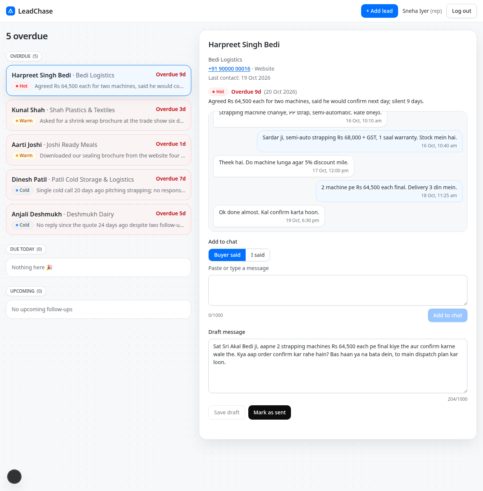
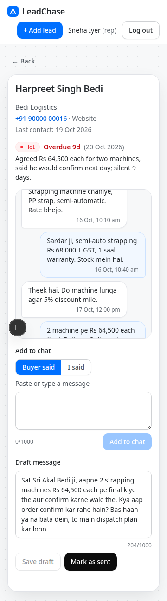

# LeadChase

An AI lead follow-up agent for a sales team. It reads each lead's chat, tags the lead Hot, Warm or Cold with a one-line reason, picks the next follow-up date and drafts the next message, so a rep sees who to call today within seconds.



<p>
  
</p>

## Live demo

Live link: https://leadchase.vercel.app

The app opens straight on the dashboard. There is no login: the brief lists login as out of scope, so the demo has no authentication by design (see [Security model and limitations](#security-model-and-limitations)).

## Features

- Today screen: leads grouped into Overdue, Due today and Upcoming, most urgent first (Hot before Warm before Cold, then most overdue).
- "Viewing as" selector in the header: pick one of the five reps (default Sneha Iyer) to see that rep's leads, or "All reps" for the team view with Hot, Warm and Cold counts and a Rep label on each card. It is a demo control, not access control.
- Per lead: chat thread, tag, one-line reason, follow-up date and an editable draft message.
- Instant open: the detail header renders at once from the list data, the full lead is fetched in one database round trip, and hovering a row prefetches it into a client-side cache.
- Mark as sent: stores the draft as a rep message and re-runs the agent over the whole chat.
- Add a chat message or a new lead; the agent re-tags and redrafts.
- Draft with agent: a button above the draft box asks Gemini for the next follow-up message and types it into the box word by word, in the language of the chat. Edit it, save it or send it; Undo restores the previous draft, Stop keeps what has appeared. A fact check flags prices, dates and offers that are not in the chat. Nothing is saved until you press Save draft or Mark as sent.
- Fast replies: add message and mark sent answer straight away with a provisional tag and date; the model's final tag and draft arrive a moment later over Supabase Realtime (a managed WebSocket). If the socket is unavailable the app polls instead, so it works either way.
- Works without a model key: a rule-based fallback keeps the app usable if Gemini is unavailable.

## How the agent works

The model (Gemini Flash) reads the chat and returns a tag, reason, follow-up gap in days and a draft. Add message and mark sent do not wait for the model: they store a rule-based provisional result, mark the lead `pending`, and write the model's result after the response. Dates are computed in code in `Asia/Kolkata`, and the gap is clamped by tag (Hot 0-1, Warm 2-5, Cold 7-14 days). Invalid output, API errors, rate limits or a 12 s timeout fall back to keyword and recency rules. Seed leads are precomputed, so the model runs only on add lead, add message and mark sent. Details are in [docs/ARCHITECTURE.md](docs/ARCHITECTURE.md).

### Draft with agent

`POST /api/leads/:id/draft-suggestion` streams one WhatsApp message as plain text and writes nothing to the database. The prompt is built in code from the whole chat: a LEAD block, a TIMELINE (days since each side last wrote, unanswered follow-ups), a FACT SHEET (prices, quantities, products, dates, rep promises, open buyer questions, language, where the buyer stands), a KNOWN vs UNKNOWN summary and a NEXT BEST ACTION chosen by rules (close politely, acknowledge a "call me later" date, answer the open question, one specific quote nudge, an easy out after repeated silence, and so on). The model is asked to write as the rep, mirror the buyer's language and length, avoid stock phrases, and say "I will confirm and revert" instead of guessing. A second layer checks the finished text for numbers, dates and offers the chat does not contain, placeholders, the wrong language and stock phrases; on a grounding or language problem the client asks for one automatic rewrite. Without a key, or if Gemini fails, a rule-based draft is streamed and labelled. The auto-draft after Add to chat / Mark as sent uses the same voice, fact sheet and next action.

## Tech stack

Next.js 15 (App Router), React 19, TypeScript, Tailwind CSS 4, Supabase (Postgres, Realtime, row level security), Google Gemini over REST, Vitest, Supabase CLI for migrations.

## Getting started

Prerequisites: Node.js 24 (see `.nvmrc`), npm, a Supabase project, and optionally a Gemini API key.

```bash
git clone <repo-url> && cd <repo-dir>
npm ci
cp .env.example .env.local            # fill in the values below
npx supabase login
npx supabase link --project-ref <your-project-ref>
npx supabase db push                  # applies all migrations: schema, RLS, Realtime, open demo access
npm run seed                          # 5 reps, 150 leads, 88 chats (needs the migrations applied first)
npm run dev                           # http://localhost:3000
```

### Environment variables

| Variable | Scope | Purpose |
| --- | --- | --- |
| `NEXT_PUBLIC_SUPABASE_URL` | public | Supabase project URL (inlined into the browser bundle) |
| `NEXT_PUBLIC_SUPABASE_PUBLISHABLE_KEY` | public | Supabase publishable (anon) key; the browser uses it only to read `leads` for live updates |
| `SUPABASE_SERVICE_ROLE_KEY` | server-only secret, required at runtime | Used by the API routes and `npm run seed`. Never prefix it with `NEXT_PUBLIC_` |
| `GEMINI_API_KEY` | server-only secret | Gemini API key; if unset the rule-based fallback is used |
| `GEMINI_MODEL` | server-only | Optional, default `gemini-2.5-flash` |
| `SUPABASE_DB_PASSWORD` | local-only secret | Used only by the Supabase CLI; never set it on Vercel |

`.env*` files are git-ignored except `.env.example`.

### Demo data

The seed (24 hand-written leads plus 126 generated ones) deletes and recreates all reps, leads and messages, with dates relative to the day it runs, so overdue and due-today items always exist. It also removes any leftover `@axon.demo` users from Supabase Auth created by older versions of the seed. All names, companies and phone numbers are fictional.

## Scripts

| Command | Description |
| --- | --- |
| `npm run dev` | Start the dev server (Turbopack) |
| `npm run build` / `npm start` | Production build and server |
| `npm run lint` | ESLint over `src`, `scripts`, `tests` |
| `npm run typecheck` | `tsc --noEmit` |
| `npm test` | Vitest unit tests |
| `npm run check` | Lint, typecheck and tests |
| `npm run seed` | Recreate demo reps, leads and chats (needs the service role key) |
| `npm run eval:draft` | Offline check of the draft prompt on 14 seeded leads against Gemini (needs `GEMINI_API_KEY`; reads seed files only, no database) |
| `npm run rls-check` | Assert anon access against a live project: can read `leads`, cannot write, cannot read `reps` or `messages` |

## Testing

```bash
npm test
npm run typecheck
npm run lint
npm run rls-check    # live Supabase project, uses the publishable key only
```

CI (`.github/workflows/ci.yml`) runs lint, typecheck, tests and a build on every push to `main` and every pull request, with placeholder env values and no secrets.

## Project structure

```
src/
  app/              dashboard page and API route handlers
  components/       Header, LeadRow, LeadDetail, ChatThread, AddLeadDialog, TagChip, BrandMark
  lib/              agent, chat, draft-* (prompt, facts, voice, check, stream), next-action, dates, urgency, validate, repo, rate limit, supabase clients
scripts/            seed.ts, seed-data.ts, seed-bulk.ts, rls-check.ts
supabase/           config.toml and migrations (schema, RLS, Realtime, open demo access)
tests/              Vitest unit tests
docs/               ARCHITECTURE.md, PERFORMANCE.md, NOTE.md, VIDEO_SCRIPT.md, screenshots
```

## Security model and limitations

- This is a demo with fictional data and **no authentication, by design**: the brief lists login as out of scope. Anyone with the URL can view and change the demo data. The "Viewing as" selector only filters what is shown.
- All writes go through the server API, which validates every input (`src/lib/validate.ts`). The API routes use one server-side Supabase client with the service role key; the key never reaches the browser.
- The browser gets only the publishable key. Row level security is enabled on every table; the only policy for `anon` is read access to `leads`, which exists so Realtime can push lead updates. `anon` cannot write anything or read `reps` or `messages` (checked by `npm run rls-check`).
- The Gemini key is used only in server code. Only `NEXT_PUBLIC_*` values are in the browser bundle.
- Draft with agent has a best-effort in-memory limit (10 drafts a minute per client IP per server instance), so it resets on cold starts and is not shared between instances.
- For production I would add real authentication (Supabase Auth) and per-user RLS policies, a user-scoped client in the API instead of the service role, a shared rate limiter and audit logging.
- Report vulnerabilities as described in [SECURITY.md](SECURITY.md).

## Performance

Opening a lead is a single database round trip, the detail header renders instantly from list data, and hovered rows are prefetched into a client cache. Measurements and details are in [docs/PERFORMANCE.md](docs/PERFORMANCE.md).

## Deployment (Vercel)

1. Import the repository into Vercel; Next.js is detected automatically.
2. Set `NEXT_PUBLIC_SUPABASE_URL` and `NEXT_PUBLIC_SUPABASE_PUBLISHABLE_KEY` before the first build (`NEXT_PUBLIC_*` values are inlined at build time).
3. Set `SUPABASE_SERVICE_ROLE_KEY` as a server-only variable and mark it Sensitive. Never give it a `NEXT_PUBLIC_` prefix.
4. Set `GEMINI_API_KEY` (Sensitive) and optionally `GEMINI_MODEL`.
5. Never set `SUPABASE_DB_PASSWORD` on Vercel; it is only for the local Supabase CLI.
6. `vercel.json` pins the function region to `icn1`; pick the region closest to your Supabase project.

## Known limitations and design decisions

- "Mark as sent" is simulated: it records the message in the app and delivers nothing to WhatsApp.
- Free Supabase projects pause after about 7 days idle; the app shows a retryable error until the project is resumed.
- Gemini free-tier rate limits fall back to rule-based suggestions, which the lead detail labels.
- Duplicate submissions are guarded in the UI and by skipping an identical repeat of the latest message; there is no database-level lock, so truly concurrent requests could interleave.
- Next: real authentication with per-user RLS, WhatsApp Business API, evals for tags and drafts, a daily digest per rep, learning from outcomes, end-to-end tests, and an atomic mark-as-sent in one database function.

## License

[MIT](LICENSE)
